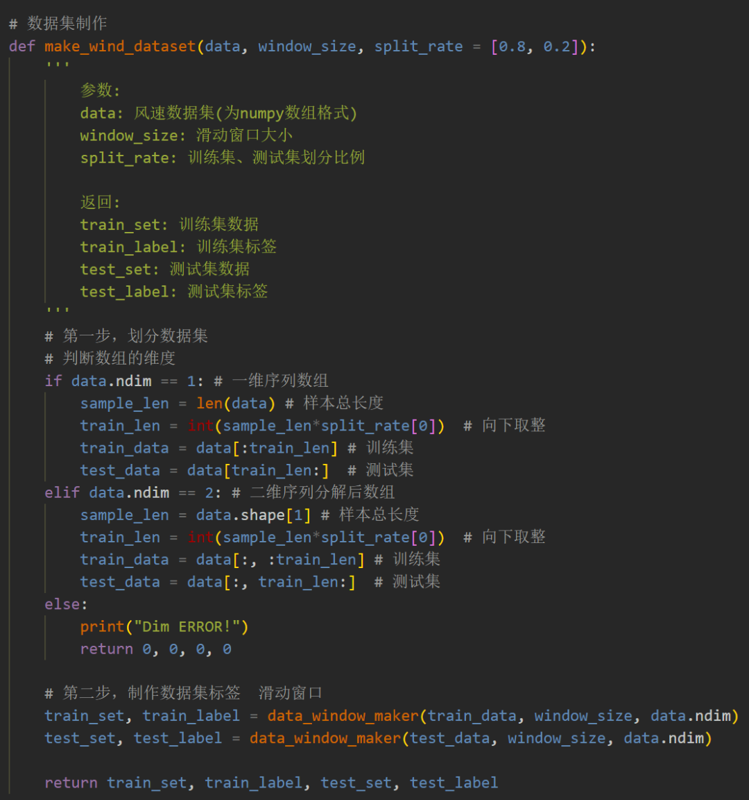
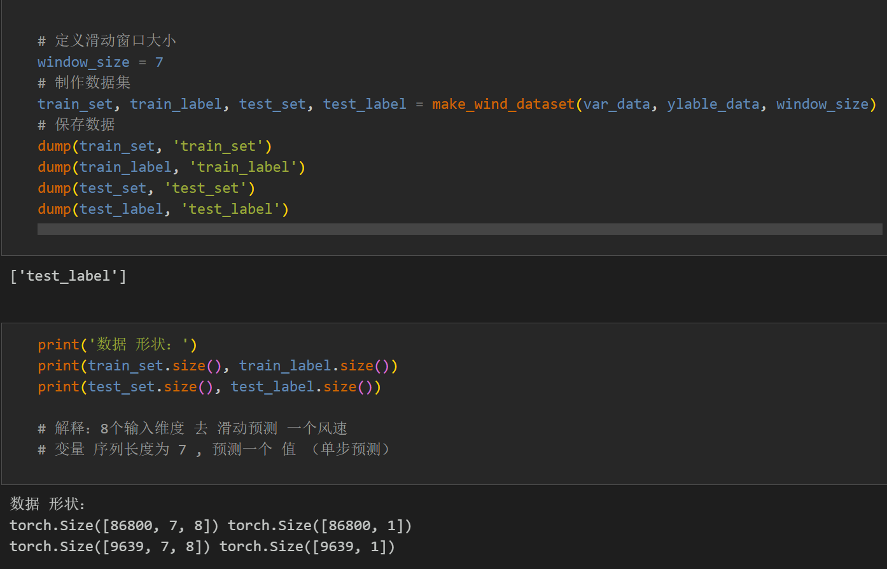
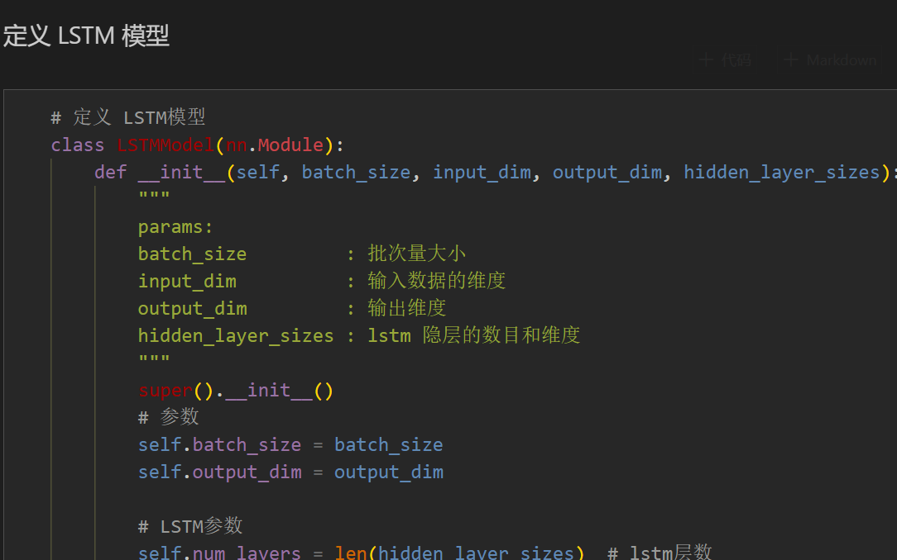
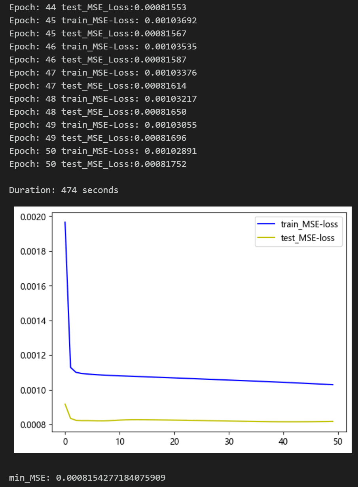
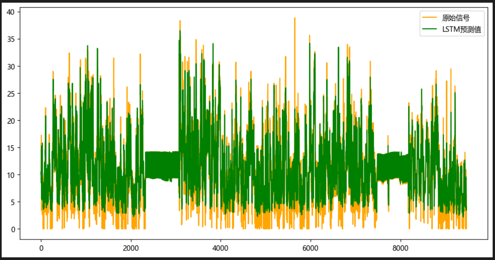
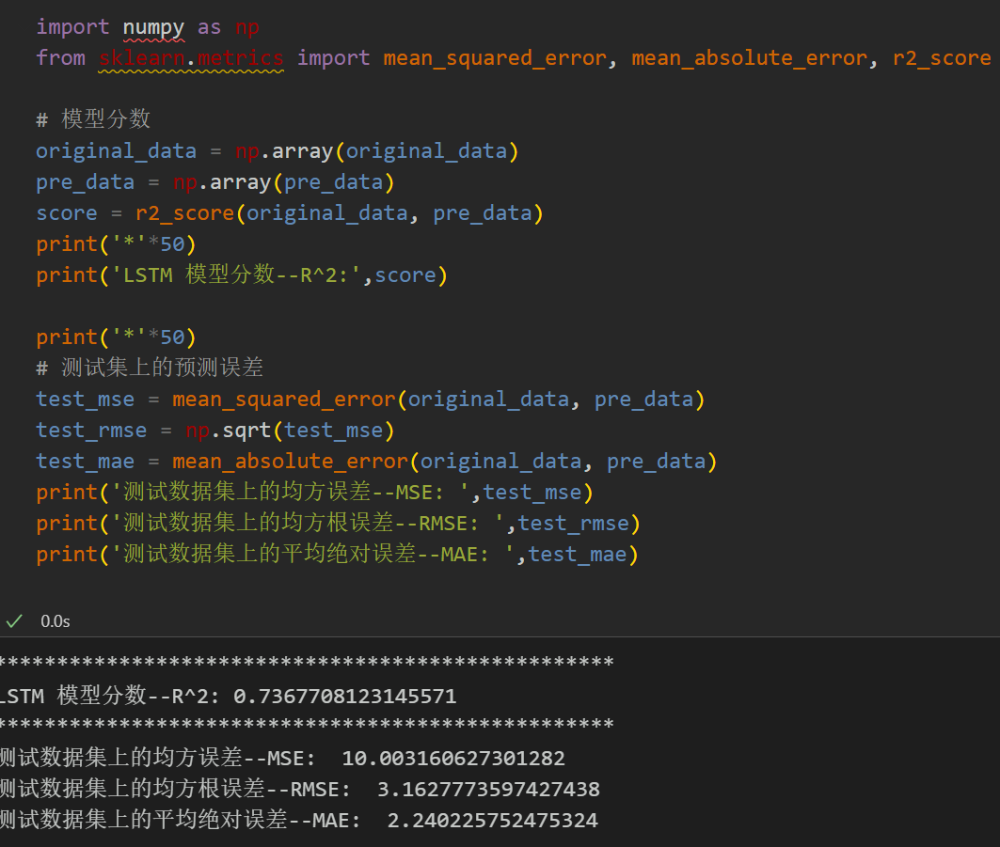

# Multi-feature Variable Sequence Prediction - LSTM Predictive Model

Single variable includes the following content:
Including wind speed data, as well as the already generated and prepared wind speed dataset and label set, corresponding codes can be run.
Includes code for data preprocessing, complete LSTM model prediction code, and visualization code.
Environment: Python 3.9
This paper introduces a multi-feature variable sequence prediction model - LSTM, based on the preliminary introduced wind speed data (see dataset at the end for details), to enhance the predictive performance of time series data. The dataset consists of nine variables including weather, temperature, humidity, pressure, and wind speed. It is created by using sliding windows to create the dataset and predicts wind speed using multiple variables.
1. Dataset Preparation and Preprocessing for Multi-Feature Variables
1.1 Import data
1.2 Dataset Preparation and Preprocessing
\tFirst, divide the dataset into training set and test set according to a ratio of 9:1.
\t  
\t  
\t\tCreating the dataset
\n    2 LSTM prediction model based on Pytorch
2.1 Define the LSTM prediction model
\n        \n      \t2.2 Set parameters and train the model
\n        \n  
50 epochs, MSE is 0.000815, the multi-variable feature LSTM prediction effect is good, appropriately adjusting model parameters can further improve the model prediction performance.
\tNote: Adjust parameters.
\tIt is appropriate to increase the number of LSTM layers and the dimensionality of hidden layers, and fine-tune the learning rate.
\tIncrease more epochs (note to prevent overfitting)
\tThe sliding window length can be changed (set the appropriate window length).
3. Model Evaluation and Visualization
3.1 Results Visualization
\n        \n  
3.2 Model Evaluation
\n        \n  

## Images

<!-- PAYMENT_BLOCK -->

## Get this dataset

- Payment link (Stripe): [Buy now](https://buy.stripe.com/3cs8yP7sY87d0vu9AB)
- Payment QR code: 

<!-- /PAYMENT_BLOCK -->
